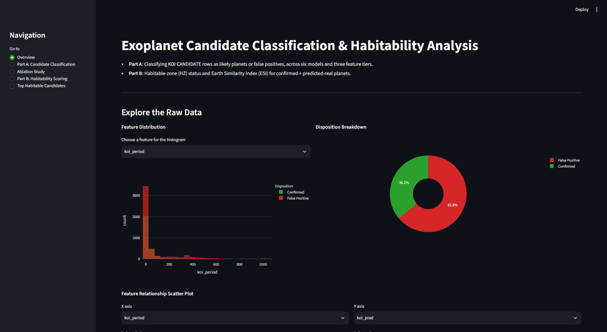
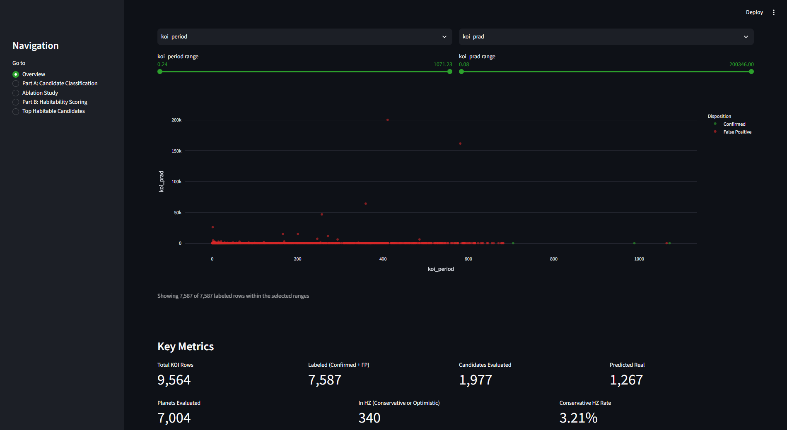
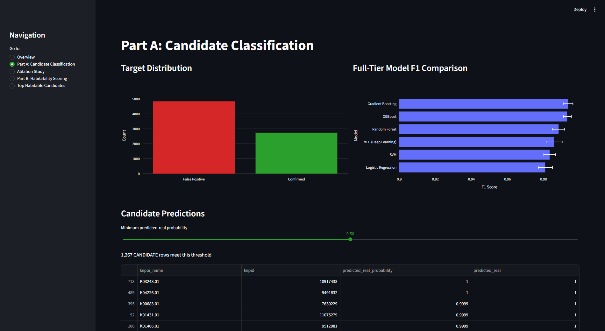
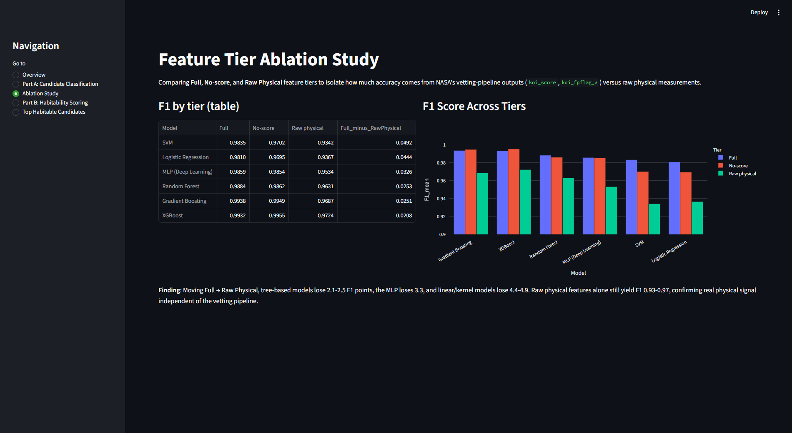
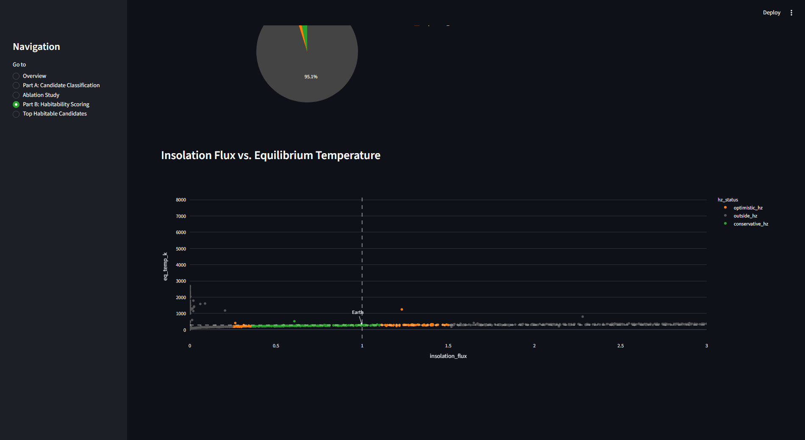
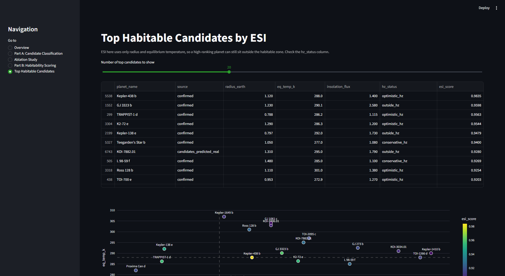

# Exoplanet Candidate Classification & Habitability Analysis

A two-part machine learning project built on NASA's Kepler and Exoplanet Archive data:

- **Part A** - Classifying Kepler Objects of Interest (KOI) `CANDIDATE` rows as likely real planets or false positives, using six models across three feature tiers to isolate how much of the model's accuracy comes from NASA's own vetting versus raw physical measurements.
- **Part B** - Combining confirmed planets with candidates predicted as likely real, then scoring each for habitable-zone status and Earth Similarity.

Two dashboards present both parts' results: an interactive Streamlit app and a static Next.js site.

## Motivation

This project extends an earlier Kepler exoplanet classification project by applying the same methodology to a harder, more open-ended task: deciding which of the Kepler mission's ~2,000 unresolved `CANDIDATE` signals are likely real planets, then asking how many of those - combined with already-confirmed planets - could plausibly sit in a habitable zone.

## Key Findings

### Part A - Candidate Classification

- Trained on 7,587 labeled rows (2,748 `CONFIRMED`, 4,839 `FALSE POSITIVE`) using 5-fold group-aware cross-validation, grouped by host (`kepid`) to prevent star-level data leakage between training and validation folds.
- Best full-feature model: **Gradient Boosting** (F1 = 0.9938), closely followed by XGBoost (F1 = 0.9932). The highest score in any tier is XGBoost on the No-score tier (F1 = 0.9955).
- Applied to the 1,977 `CANDIDATE` rows, the final Gradient Boosting model predicts 1,267 as likely real.
- A three-tier ablation study (Full / No-score / Raw physical) found that removing NASA's own vetting pipeline outputs (`koi_score`, `koi_fpflag_*`) drops F1 by 2.1-2.5 points for tree models, 3.3 points for the MLP, and 4.4-4.9 points for linear/kernel models. Vetting pipeline features contribute real signal, but raw physical/transit measurements alone still produce strong classifiers (F1 0.93-0.97). MLP scores can vary slightly between runs.

**Limits of these scores:** they measure performance on labeled rows, and may overstate accuracy on `CANDIDATE` rows, whose true labels are unknown. 98.0% of labeled false positives have at least one `koi_fpflag_*` flag set, compared with 0.66% of confirmed planets and only 0.15% of candidates. So the signal that most easily identifies false positives in training is almost never present in the rows the final model is applied to. Median imputation in Phase 2 also uses all rows, before the cross-validation splits, so a small amount of information is shared between folds.

### Part B - Habitability Scoring

- Combined 5,737 confirmed planets (the PSCompPars rows with both insolation flux and radius, out of 6,366, spanning Kepler/K2/TESS/ground-based) with the 1,267 predicted-real candidates, for 7,004 planets in total.
- Computed habitable-zone status via insolation flux, using Kopparapu et al.-derived bounds (Conservative: 0.36-1.11 S⊕, Optimistic: 0.25-1.5 S⊕) and a radius-based rocky-planet filter (< 1.6 Earth radii).
- **3.21%** of all evaluated planets fall in the conservative habitable zone; **4.85%** including the optimistic zone. 38 planets are both likely rocky and in either zone (31 confirmed, 7 predicted-real candidates).
- Confirmed planets and predicted-real candidates show similar conservative-HZ rates (3.22% vs 3.16%). This is a descriptive comparison only: the two groups come from different surveys and selection effects, so it doesn't show that the Part A classifier is unbiased.
- Computed a simplified Earth Similarity Index (ESI) per planet, using only radius and equilibrium temperature. Some well-known planets rank highly - Kepler-438 b (1st), TRAPPIST-1 d (3rd), Teegarden's Star b (6th), TOI-700 d (20th) - while others sit much lower: TRAPPIST-1 e (88th), Proxima Centauri b (266th), TRAPPIST-1 f (267th), TRAPPIST-1 g (499th), Kepler-186 f (825th). Because ESI ignores insolation flux, 24 of the top 50 fall outside the habitable zone, so it's a rough Earth-similarity measure rather than a habitability ranking.

## Dashboards

The project has two dashboards, both built from the same processed data:

- **Streamlit (`app.py`)** - the full interactive version, reading the CSVs in `data/processed/` directly. The screenshots below show this app.
- **Next.js (`frontend/`)** - a static presentation version with Overview, Part A, Ablation, Part B, and Top Candidates pages. It reads JSON files generated by `src/export_json.py`. It doesn't yet include Streamlit's data explorer, target distribution chart, or candidate predictions table.

### Overview - Explore the Raw Data




### Part A - Candidate Classification



### Ablation Study - Feature Tier Comparison



### Part B - Habitability Scoring



### Top Habitable Candidates



## Methodology

### Data Sources

- **KOI Cumulative Table** - NASA Exoplanet Archive TAP service, 9,564 rows, 153 columns. Source for Part A.
- **PSCompPars (Planetary Systems Composite Parameters)** - NASA Exoplanet Archive TAP service, 6,366 rows, 703 columns. Source for Part B.

### Pipeline

1. **Phase 1 - Data Loading & Exploration**: load both datasets, inspect shape, target distribution, missing values.
2. **Phase 2 - Cleaning & Feature Selection**: drop fully-empty and non-predictive columns, keep `kepid` and `kepoi_name` as identifiers, median-impute missing numeric values, and split into labeled (`CONFIRMED`/`FALSE POSITIVE`) and candidate sets.
3. **Phase 3 - Candidate Classification**: train Random Forest, XGBoost, Gradient Boosting, SVM, Logistic Regression, and an MLP deep learning model, with 5-fold group-aware cross-validation across three feature tiers (Full / No-score / Raw physical). Apply the best full-tier model to `CANDIDATE` rows.
4. **Phase 4 - Habitability Scoring**: merge confirmed + predicted-real planets, compute HZ status (insolation-flux-based) and a simplified ESI score.
5. **Phase 5 - Dashboards**: present both parts' results in a Streamlit app and a Next.js site, with `src/export_json.py` generating the Next.js site's data.

## Project Structure

```text
exoplanet-habitability-project/
├── app.py                  # Streamlit dashboard
├── .streamlit/
│   └── config.toml         # Dark theme config
├── data/
│   ├── raw/                # Downloaded datasets (gitignored)
│   └── processed/          # Cleaned/derived datasets
├── docs/
│   └── screenshots/        # Streamlit dashboard screenshots
├── frontend/               # Next.js dashboard
│   ├── app/                # Pages
│   ├── components/         # Shared UI components
│   ├── lib/                # Types and data helpers
│   └── public/data/        # JSON generated by src/export_json.py
├── notebooks/
│   ├── Phase1_data_loading.ipynb
│   ├── Phase2_data_cleaning.ipynb
│   ├── Phase3_candidate_classification.ipynb
│   └── Phase4_habitability_scoring.ipynb
├── src/
│   ├── download_data.py    # NASA Exoplanet Archive data fetch script
│   ├── export_json.py      # Converts processed data to JSON for the Next.js site
│   └── test_load.py        # Quick check that the raw datasets load
├── requirements.txt
└── README.md
```

## Setup

The processed data and generated JSON are committed, so both dashboards run without downloading anything.

### Streamlit Dashboard

Start the app from the repository root, because it reads its data using relative paths:

```bash
git clone https://github.com/aditya-patra1011/exoplanet-habitability-project.git
cd exoplanet-habitability-project

python -m venv venv
source venv/Scripts/activate    # Windows (Git Bash)
# source venv/bin/activate      # macOS/Linux

pip install -r requirements.txt

streamlit run app.py
```

### Next.js Dashboard

Requires Node.js 20.9 or newer:

```bash
cd frontend
npm install
npm run dev
```

Then open http://localhost:3000.

### Re-running the Pipeline

```bash
python src/download_data.py     # downloads data/raw/*.csv
```

Next, run the notebooks in order, from Phase 1 to Phase 4. Newly downloaded data may differ from the committed results, because the NASA archive is updated over time.

To update the Next.js dashboard's data afterwards, run this from the repository root:

```bash
python src/export_json.py
```

Some findings text is written by hand in `app.py`, `frontend/app/ablation/page.tsx`, and this README, so check it against the new results.

## Tech Stack

- **Data & ML**: pandas, NumPy, scikit-learn, XGBoost, TensorFlow/Keras
- **Dashboards**: Streamlit and Plotly; Next.js, React, TypeScript, Tailwind CSS, and Recharts
- **Exploration**: Jupyter, Matplotlib
- **Data Source**: NASA Exoplanet Archive (TAP API)

## Scope Note

This project estimates habitable-zone status based on standard astronomical criteria (insolation flux, equilibrium temperature, planet radius) - it identifies planets where a rocky world _could_ plausibly sustain liquid surface water, under commonly used simplifying assumptions. It does not assess atmospheric composition, surface conditions, or human survivability; "habitable zone" is a well-defined astronomical term describing orbital conditions, not a claim about livability.

## Related Project

This project builds on an earlier [Kepler Exoplanet Classification](https://github.com/aditya-patra1011/kepler-exoplanet-classification) project, which established the feature-tier ablation methodology used here in Part A.

## Future Improvements

- SHAP-based interpretability for individual candidate predictions
- Light curve visualization for top predicted-real candidates
- Host star type analysis for habitable-zone planets
- Discovery-rate timeline by mission/facility
- Add the Streamlit-only features to the Next.js dashboard
- Automated tests and CI
